# Day 5 · Introduction to Bulk RNA-Seq

**Experimental design, wet-lab overview, dry-lab overview**

## 📑 Table of Contents

1. [What is omics data?](#2-what-is-omics-data)
2. [Types of omics data](#3-types-of-omics-data)
3. [Integrated multi-omics data](#4-integrated-multi-omics-data)
4. [Single omics vs. multi-omics](#5-single-omics-vs-multi-omics)
5. [A quick word on meta-analysis](#6-a-quick-word-on-meta-analysis)
6. [Introduction to transcriptomics](#7-introduction-to-transcriptomics)
7. [Types of transcriptomics](#8-types-of-transcriptomics)
8. [Introduction to RNA-seq](#9-introduction-to-rna-seq)
9. [The 3 steps of RNA-seq](#10-the-3-steps-of-rna-seq)
10. [Wet lab: preparing an RNA-seq library (6 steps)](#11-wet-lab-preparing-an-rna-seq-library-6-steps)
11. [How sequencing works](#12-how-sequencing-works)
12. [The result: raw data (FASTQ)](#13-the-result-raw-data-fastq)
13. [Dry lab preview: what happens next](#14-dry-lab-preview-what-happens-next)
14. [Summary](#15-summary)
15. [Quick-check questions](#16-quick-check-questions)
16. [Glossary](#17-glossary)
17. [References and further reading](#18-references-and-further-reading)

## 1. What is omics data?

**Omics data is information generated by studies whose names end with "-omics"**, such as genomics, proteomics, and phenomics.

The suffix **-ome** means *"the complete set of"*, and **-omics** means *"the study of that complete set"*. Instead of looking at one gene or one protein at a time, omics looks at **everything at once**.

| Word               | Meaning                                              |
| ------------------ | ---------------------------------------------------- |
| **Gene**     | One single unit of heredity (one piece of DNA)       |
| **Genome**   | The *complete set* of all genes/DNA in an organism |
| **Genomics** | The *study* of the genome                          |

### The layers of biology

Biological information flows from DNA to RNA to protein. Each layer has its own "-ome" and its own "-omics" field:

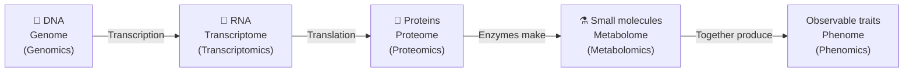

**Epigenomics** sits on top of the genome. It studies chemical marks on DNA that switch genes on or off *without changing the DNA sequence itself*.

---

## 2. Types of omics data

Every field whose name ends in *"omic"* belongs to the omics family. The main ones:

| Field                     | What it studies                                                                  |
| ------------------------- | -------------------------------------------------------------------------------- |
| **Genomics**        | An organism's complete DNA (genome)                                              |
| **Epigenomics**     | Chemical modifications that regulate DNA                                         |
| **Transcriptomics** | All RNA transcripts produced by a genome                                         |
| **Proteomics**      | The proteome, the full set of proteins in an organism                            |
| **Metabolomics**    | Metabolites: small molecules produced during metabolism                          |
| **Metagenomics**    | Genetic material recovered directly from natural environments (soil, gut, water) |
| **Phenomics**       | The total phenotypic characteristics (observable traits) of an organism          |

---

## 3. Integrated multi-omics data

**Multi-omics data analysis** is the *integrated* study of different "omics" layers (genomics, transcriptomics, proteomics, metabolomics, epigenomics, and so on) **from the same biological system**. The goal is a **comprehensive understanding of biology, disease or phenotype**.

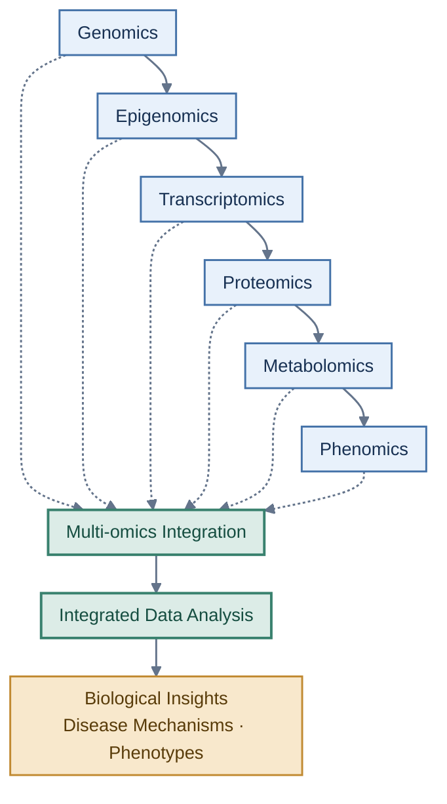

Two extra dimensions matter in real studies:

- **Organisation level:** organelle → cell → organ → organism
- **Age / environment:** the same layers change with time and surroundings

---

## 4. Single omics vs. multi-omics

|                             | **Single omics**     | **Multi-omics**                                          |
| --------------------------- | -------------------------- | -------------------------------------------------------------- |
| **Looks at**          | One layer (e.g., only RNA) | Several layers together                                        |
| **Question answered** | "Which genes are active?"  | "How do DNA, RNA, proteins and metabolites *work together*?" |
| **Complexity**        | Lower                      | Much higher                                                    |
| **Cost and effort**   | Lower                      | Higher                                                         |
| **Example**           | Bulk RNA-seq               | RNA-seq + proteomics + metabolomics on the same patients       |

---

## 6. A quick word on meta-analysis

A **meta-analysis** combines the results of **several independent studies or datasets** to reach a stronger, more reliable conclusion than any single study could give.

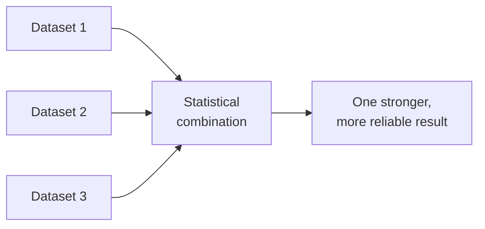

**Why it matters:**

- Small studies have low statistical power, and pooling them increases it.
- It shows whether a finding **replicates** across labs and populations.
- Public data (GEO, SRA) makes it possible for anyone to do.

> **Don't confuse these two:**
> **Meta-analysis** = combining *results from many studies*.
> **Meta**transcriptomics = studying RNA from *whole communities of organisms* (see [Section 8.4](#84-meta-transcriptomics)).

---

## 7. Introduction to transcriptomics

### 7.1 What is transcriptomics?

**Transcriptomics** is the field of science that deals with the study of the **transcriptome**, the collection of **all RNA transcripts** produced within specific cells of an organism.

| Term                      | Meaning                                                                   |
| ------------------------- | ------------------------------------------------------------------------- |
| **Transcription**   | The process of copying a gene (DNA) into an RNA molecule                  |
| **Transcript**      | One RNA molecule made from a gene                                         |
| **Transcriptome**   | The *complete set* of transcripts in a cell or sample at a given moment |
| **Transcriptomics** | The *study* of the transcriptome                                        |

### Why is the transcriptome more interesting than the genome?

- Almost every cell in your body has the **same genome**, yet a neuron and a muscle cell behave very differently.
- The difference is **which genes are switched on**, and that shows up in the **transcriptome**.
- Complexity rises as we go from genome to transcriptome to proteome:

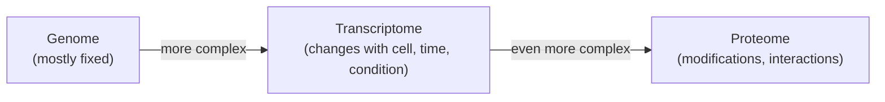

### 7.2 Why use transcriptomes in biological research?

| Pros                                                                            | Cons                                                                                         |
| ------------------------------------------------------------------------------- | -------------------------------------------------------------------------------------------- |
| Easy, accessible way to see and **quantify gene expression**              | It is a **snapshot in time**. Different times give different expression patterns       |
| Immediate access to the **protein-coding portion** of the genome          | **Absence of a gene** in the data does **not** mean it is absent from the genome |
| Can identify **alternative splicing**                                     | Hard to be sure you sampled a **single cell type**                                     |
| Can identify **SNPs** (Single Nucleotide Polymorphisms) in coding regions | Statistical analysis is **highly dependent on experimental design**                    |

**Plain-English explanations:**

- **Gene expression:** how *active* a gene is, meaning how many RNA copies it is making.
- **Alternative splicing:** one gene can be cut and joined in different ways to make *different RNA versions* (and so different proteins).
- **SNP:** a single-letter DNA difference between individuals (e.g., A instead of G).
- **Snapshot problem:** if you measure at 9 AM and again at 9 PM, the transcriptome can look very different.
- **Absence ≠ missing gene:** the gene may simply be switched *off* in that sample.

---

## 8. Types of transcriptomics

Transcriptomics comes in several "flavours", depending on *what question you ask* and *at what resolution*.

| Type                  | Resolution                     | Key question                                      |
| --------------------- | ------------------------------ | ------------------------------------------------- |
| **Bulk**        | Average of thousands of cells  | "Which genes differ between conditions overall?"  |
| **Single-cell** | One cell at a time             | "Which cell types exist, and what is each doing?" |
| **Spatial**     | Position in the tissue         | "*Where* in the tissue is each gene active?"    |
| **Meta**        | Whole communities of organisms | "What is the whole community doing?"              |

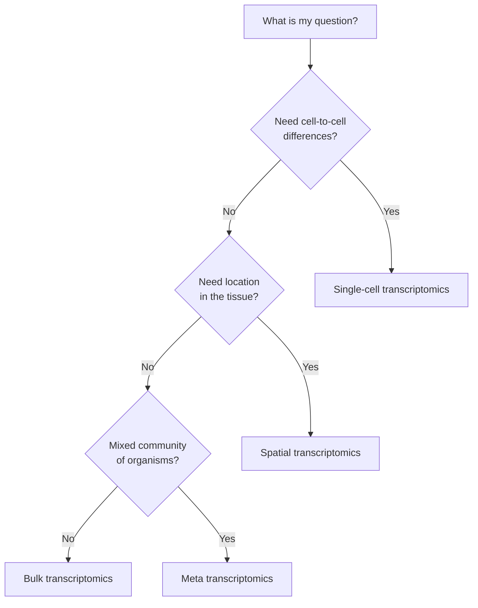

### 8.1 Bulk transcriptomics

- Analyses gene expression in samples containing **thousands to millions of cells** and gives an **average expression profile**.
- **RNA-seq** is the main method used.
- Lets you analyse **thousands of genes at once** with **quantitative expression data** (counts).
- **Limitation:** it **cannot capture cell-to-cell variability or rare cell types**.

> 💡 **Analogy:** Bulk RNA-seq is like blending a fruit salad into a smoothie and tasting it. You learn the *average flavour*, but you can't tell which fruit contributed what.

**Typical outputs** (you'll make these in the coming days): PCA plots, volcano plots, heatmaps, and pathway/GO enrichment plots.

### 8.2 Single-cell transcriptomics

- Measures gene expression at the **individual cell level**.
- Reveals **cellular diversity** and **rare cell types** that bulk methods miss.
- Essential for understanding different cell types and biological processes in multicellular organisms.
- Enables discovery of **novel cell types** and **cell-specific functions**.

> 💡 **Analogy:** Instead of the smoothie, you taste *every fruit piece separately*.

**Typical outputs:** UMAP plots (cells clustered by similarity) and marker-gene expression maps. These are covered in **Module 3**.

### 8.3 Spatial transcriptomics

- Measures gene expression **with spatial context preserved**.
- Helps understand **cell organisation, interactions, and tissue structure**.
- Bulk and single-cell methods **lose spatial information**, because the tissue is broken apart before measuring.
- Uses **imaging-based** and **sequencing-based** technologies.

> 💡 **Analogy:** Instead of a list of ingredients, you get the *photograph of the finished dish* with each ingredient's position marked.

Covered in **Module 4**.

### 8.4 Meta-transcriptomics

- Studies gene expression of **entire organism communities** (microbes, plants, animals, and so on).
- Originally focused on **microbes**, but now includes **all organisms in a sample**.
- Useful for analysing **functions and interactions in natural environments**.
- Commonly applied to **gut, soil, and water microbiomes**.

> 📝 **Also shown in the class figure:**
>
> - The "Dataset 1 / 2 / 3" picture illustrates **meta-analysis** (see [Section 6](#6-a-quick-word-on-meta-analysis)).
> - **circRNA transcriptomics** studies *circular RNAs*, RNA molecules joined end-to-end into a closed loop. They are more stable than normal linear RNAs and are studied as potential disease markers.

---

## 9. Introduction to RNA-seq

### 9.1 The core scientific question

Imagine two groups of cells:

- 🔵 **Normal neural cells**
- 🔴 **Mutated neural cells**

The mutated cells **behave differently** from the normal ones. We want to know:

> **What genetic mechanism is causing the difference?**

Since both cell types carry (almost) the same DNA, the difference usually lies in **which genes are active**. In other words, we want to look at **differences in gene expression**.

### 9.2 How genes become measurable

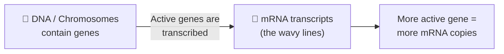

- Some genes are **active** and produce **many mRNA transcripts**.
- Some genes are **less active** and produce few (or none).
- **Counting transcripts tells us how active each gene is.** That is the idea behind RNA-seq.

### 9.3 Comparing normal vs. mutated cells

If we count the transcripts for each gene in both cell types, we can compare them and find *what is different in the mutated cells*.

Here is a simplified example (illustrative numbers, based on the figure from class):

| Gene             | 🔵 Normal cells (transcripts) | 🔴 Mutated cells (transcripts) | Interpretation                                 |
| ---------------- | ----------------------------- | ------------------------------ | ---------------------------------------------- |
| **Gene 1** | 3                             | 3                              | No change                                      |
| **Gene 2** | 0                             | 5                              | ⬆️ **Up-regulated** in mutated cells   |
| **Gene 3** | 5                             | 3                              | ⬇️ **Down-regulated** in mutated cells |

> 🔑 **This is the heart of differential expression analysis**, which you'll do from **Day 7** onward.

**Vocabulary check**

- **Up-regulated:** more active in condition B than in condition A.
- **Down-regulated:** less active in condition B than in condition A.
- **Differential expression (DE):** a *statistically supported* difference in expression between conditions.

---

## 10. The 3 steps of RNA-seq

Every RNA-seq experiment follows the same three-stage path:

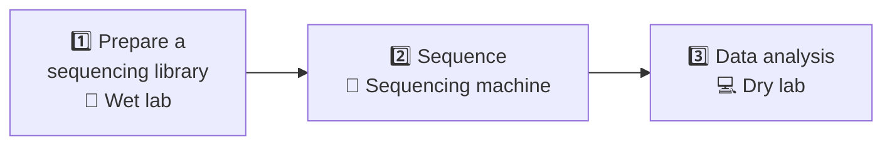

| Step                                      | Where              | What happens                                                                |
| ----------------------------------------- | ------------------ | --------------------------------------------------------------------------- |
| **1. Prepare a sequencing library** | Wet lab            | Convert RNA into DNA fragments the machine can read                         |
| **2. Sequence**                     | Sequencer          | The machine reads the fragments base by base                                |
| **3. Data analysis**                | Dry lab (computer) | QC → alignment/quantification → differential expression → interpretation |

> 🧪 **Wet lab** = work with physical samples, chemicals, and instruments.
> 💻 **Dry lab** = work on computers with data. *This is where bioinformaticians live!*

---

## 11. Wet lab: preparing an RNA-seq library (6 steps)

A **sequencing library** is a collection of DNA fragments with the right **adaptors** attached, ready to be loaded onto a sequencer.

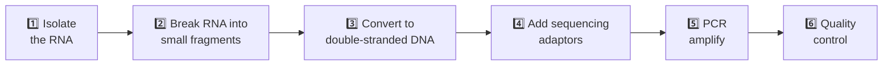

### Step 1: Isolate the RNA

- RNA is extracted from the cells or tissue.
- Quality matters a lot because **RNA degrades very easily**. Samples are handled quickly, kept cold, and protected from RNases (enzymes that destroy RNA).
- RNA integrity is often checked with a **RIN score** (RNA Integrity Number, from 1 to 10; higher is better).

> 📝 **Extra context (not on the slide):** Most RNA in a cell is **ribosomal RNA (rRNA)**, which is usually not what we want. Labs either **enrich mRNA** (poly-A selection) or **remove rRNA** (rRNA depletion) around this step.

### Step 2: Break the RNA into small fragments

- Full-length RNA molecules are too long for the sequencer.
- They are chopped into **small pieces** (a few hundred bases).

### Step 3: Convert the RNA fragments into double-stranded DNA

- Sequencers read **DNA**, not RNA.
- An enzyme called **reverse transcriptase** makes **complementary DNA (cDNA)** from the RNA, then the second strand is synthesised, giving **double-stranded cDNA**.

> 💡 This is why the "RNA" fragments in the diagram turn from blue (RNA) to black (DNA).

### Step 4: Add sequencing adaptors

- Short, known DNA sequences called **adaptors** are attached to **both ends** of every fragment.
- Adaptors let the fragments **stick to the flow cell** and give the machine a **starting point** to read from.
- They often also carry **barcodes (indexes)**, so many samples can be mixed and sequenced together, then separated by computer later.

```
 ┌────────┬───────────────────────┬────────┐
 │Adaptor │   Your cDNA fragment  │Adaptor │
 │ (red)  │        (black)        │ (blue) │
 └────────┴───────────────────────┴────────┘
```

### Step 5: PCR amplify

- **PCR** (Polymerase Chain Reaction) makes **many copies** of each fragment.
- This produces enough material to sequence. Only fragments with adaptors on both ends are amplified well.

> ⚠️ **Watch out:** PCR can introduce **bias** and **duplicate reads**, which is one reason QC later in the dry lab matters.

### Step 6: Quality control (QC)

Before sequencing, the library is checked for two things:

1. ✅ **Verify library concentration.** Is there enough material?
2. ✅ **Verify library fragment lengths.** Are the fragments the right size?

> Typical tools include a fluorometer (e.g., Qubit) for concentration and a Bioanalyzer or TapeStation for fragment size.

---

## 12. How sequencing works

> The slides explain a *simplified* version of **sequencing by synthesis**, the idea behind Illumina sequencers, the most common technology for RNA-seq.

### 12.1 The big picture

- The library fragments are loaded onto a glass slide called a **flow cell**.
- Each fragment sticks to the flow cell and is **copied many times in place**, forming a tiny **cluster** of identical fragments. This makes the signal bright enough to detect.
- In reality, there are **hundreds of millions of fragments** (the slide uses about **400,000,000**) laid out in a dense grid.

```
        Flow cell (viewed from the side)

   G         C   A         T
   C         C   A         T
   A         A   C         C       ← each vertical column is one
   G         T   G         A         fragment/cluster being read
   C         T   T         G
   A         A   A         A
   C         T   T         G
   A         C   C         G
 ████████████████████████████████
          (flow-cell surface)
```

### 12.2 One cycle at a time

Each **cycle** adds **one fluorescently labelled base** to every fragment:

| Colour    | Base        |
| --------- | ----------- |
| 🔴 Red    | **A** |
| 🔵 Blue   | **G** |
| 🟢 Green  | **C** |
| 🟠 Orange | **T** |

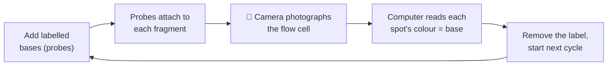

1. Labelled bases attach to the growing strand on every fragment.
2. The machine takes a **picture of the flow cell from above**. Each glowing dot is one fragment, and its **colour tells the base**.
3. Example from class: a 🔴 red dot in the bottom-left corner means the first base there is **"A"**.
4. The label is removed and the process **repeats** until each fragment's full sequence is read.

### 12.3 Worked example: 4 fragments

Reading each column from the **bottom up**, one cycle per base:

|     Cycle     |  Fragment 1  |  Fragment 2  |  Fragment 3  |  Fragment 4  |
| :------------: | :----------: | :----------: | :----------: | :----------: |
|  **1**  |     🔴 A     |     🟢 C     |     🟢 C     |     🔵 G     |
|  **2**  |     🟢 C     |     🟠 T     |     🟠 T     |     🔵 G     |
|  **3**  |     🔴 A     |     🔴 A     |     🔴 A     |     🔴 A     |
|  **4**  |     🟢 C     |     🟠 T     |     🟠 T     |     🔵 G     |
|  **5**  |     🔵 G     |     🟠 T     |     🔵 G     |     🔴 A     |
|  **6**  |     🔴 A     |     🔴 A     |     🟢 C     |     🟢 C     |
|  **7**  |     🟢 C     |     🟢 C     |     🔴 A     |     🟠 T     |
|  **8**  |     🔵 G     |     🟢 C     |     🔴 A     |     🟠 T     |
| **Read** | `ACACGACG` | `CTATTACC` | `CTATGCAA` | `GGAGACTT` |

> 🔑 With **4 fragments** this is easy to picture. With **~400,000,000 fragments**, the matrix is **much denser**. The computer does the same thing, just at enormous scale.

Each of these decoded strings is called a **read**.

---

## 13. The result: raw data (FASTQ)

After sequencing, the machine gives us **millions of reads**, stored in **FASTQ** files. This is the **raw data** and the **starting point of all bioinformatics analysis**.

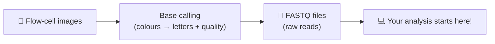

### 13.1 What is inside a FASTQ file?

Each read takes **exactly 4 lines**:

```text
@READ_001 instrument:run:flowcell:lane
GATTACAGATTACA
+
IIIIIHHHGGG###
```

| Line | Content            | Meaning                                                |
| :--: | ------------------ | ------------------------------------------------------ |
|  1  | `@READ_001 ...`  | **Read ID**, the unique name (starts with `@`) |
|  2  | `GATTACAGATTACA` | The **sequence** of bases                        |
|  3  | `+`              | Separator (sometimes repeats the ID)                   |
|  4  | `IIIIIHHHGGG###` | **Quality scores**, one character per base       |

### 13.2 Understanding quality scores (Phred)

Each character in line 4 encodes how **confident** the machine is about the base at that position.

- **Q = −10 × log₁₀(P)**, where *P* is the probability the base call is wrong.
- In the common **Phred+33** encoding, `Q = ASCII value of the character − 33`.

| Phred score (Q) | Chance base is wrong | Accuracy | Example character |
| :-------------: | :------------------: | :------: | :---------------: |
|       10       |       1 in 10       |   90 %   |       `+`       |
|       20       |       1 in 100       |   99 %   |       `5`       |
|       30       |      1 in 1,000      |  99.9 %  |       `?`       |
|       40       |     1 in 10,000     | 99.99 % |       `I`       |

> ✅ **Rule of thumb:** **Q30 or higher** is considered good quality.
> In the example above, `I` = Q40 (excellent) while `#` = Q2 (very unreliable).

### 13.3 Single-end vs. paired-end

|                        | **Single-end**     | **Paired-end**                                          |
| ---------------------- | ------------------------ | ------------------------------------------------------------- |
| **What is read** | One end of each fragment | **Both** ends of each fragment                          |
| **Files**        | `sample.fastq.gz`      | `sample_R1.fastq.gz` + `sample_R2.fastq.gz`               |
| **Advantage**    | Cheaper                  | Better mapping accuracy, detects splice junctions more easily |

> 📦 FASTQ files are usually **compressed** (`.fastq.gz` or `.fq.gz`) because they're huge. A single sample can be several gigabytes. **Do not push these to GitHub.** Keep them out of the repo using `.gitignore`.

---

## 14. Dry lab preview: what happens next

Now the bioinformatician takes over. Here is the roadmap you will follow over the next sessions:

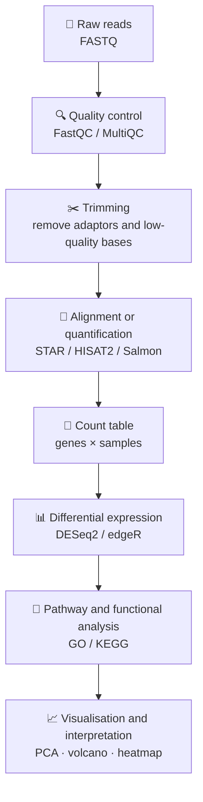

| Upcoming day     | Topic                                                     |
| ---------------- | --------------------------------------------------------- |
| **Day 6**  | From FASTQ to counts matrix                               |
| **Day 7**  | From count table to differential gene expression analysis |
| **Day 8**  | From differential expression to pathways                  |
| **Day 9**  | Batch effects and complex experimental designs            |
| **Day 10** | Bulk RNA-seq meta-analysis                                |

### A note on experimental design

Since statistical analysis is **highly dependent on experimental design** (remember the con from Section 7.2), plan these *before* the wet lab:

- **Biological replicates.** Several independent samples per condition, so you can tell real biological differences from random noise. More replicates mean more statistical power.
- **Controls.** A proper comparison group (e.g., normal vs. mutated, treated vs. untreated).
- **Batch effects.** Avoid processing all of one condition on one day and all of another on a different day. Mix conditions across batches.
- **Sequencing depth.** Enough reads per sample to detect the genes you care about.

> 📌 These are covered in detail in the following sessions (especially **Day 9**).

---

## 15. Summary

| Concept                        | One-line takeaway                                                                     |
| ------------------------------ | ------------------------------------------------------------------------------------- |
| **Omics**                | Studying *all* molecules of one type at once (genome, transcriptome, proteome, ...) |
| **Multi-omics**          | Integrating several omics layers from the same system                                 |
| **Transcriptomics**      | The study of all RNA transcripts, i.e. which genes are active                         |
| **Pros and cons**        | Great for quantifying expression, but it's a *snapshot*, and design matters         |
| **Bulk**                 | Average across many cells (**our focus**)                                       |
| **Single-cell**          | One cell at a time                                                                    |
| **Spatial**              | Expression plus location                                                              |
| **Meta**                 | Whole communities of organisms                                                        |
| **RNA-seq idea**         | Count transcripts to compare gene activity between conditions                         |
| **3 steps**              | Library prep → Sequencing → Data analysis                                           |
| **6 library prep steps** | Isolate RNA → Fragment → Make dsDNA → Add adaptors → PCR → QC                    |
| **Sequencing**           | Fluorescent bases + camera, cycle by cycle, on millions of fragments                  |
| **Raw data**             | FASTQ files: reads + quality scores                                                   |

---

## 16. Quick-check questions

Try answering before opening the answers.

**Q1.** What does the suffix *-omics* mean?

<details><summary>Answer</summary>The study of the <i>complete set</i> of a type of biological molecule (e.g., all genes, all RNA, all proteins).</details>

**Q2.** What is the difference between the genome and the transcriptome?

<details><summary>Answer</summary>The genome is the complete DNA, which is mostly fixed. The transcriptome is the set of all RNA transcripts, which changes with cell type, time, and condition.</details>

**Q3.** Give one advantage and one limitation of transcriptomics.

<details><summary>Answer</summary>Advantage: quantifies gene expression (also finds splicing and SNPs in coding regions). Limitation: only a snapshot in time; absence of a gene does not mean it is missing from the genome; heavily dependent on experimental design.</details>

**Q4.** Why can't bulk RNA-seq find rare cell types?

<details><summary>Answer</summary>It measures the <i>average</i> expression across thousands of cells, so signals from rare cells are diluted.</details>

**Q5.** Which type of transcriptomics preserves tissue location?

<details><summary>Answer</summary>Spatial transcriptomics.</details>

**Q6.** What are the 3 steps of RNA-seq?

<details><summary>Answer</summary>Prepare a sequencing library → Sequence → Data analysis.</details>

**Q7.** Why do we convert RNA to DNA during library preparation?

<details><summary>Answer</summary>Sequencers read DNA, not RNA, so RNA is reverse-transcribed into cDNA.</details>

**Q8.** What do adaptors do?

<details><summary>Answer</summary>They let fragments attach to the flow cell, provide a starting point for sequencing, and often carry barcodes to tell samples apart.</details>

**Q9.** In the sequencing picture, a red dot appears at a position. Which base is it (using the slide's colour code)?

<details><summary>Answer</summary>A (red = A, blue = G, green = C, orange = T).</details>

**Q10.** A base has a Phred score of 30. How likely is it to be wrong?

<details><summary>Answer</summary>1 in 1,000 (99.9 % accurate).</details>

---

## 17. Glossary

| Term                              | Definition                                                             |
| --------------------------------- | ---------------------------------------------------------------------- |
| **Adaptor**                 | Short known DNA sequence added to fragment ends for sequencing         |
| **Alternative splicing**    | Producing different RNA versions from one gene                         |
| **Base calling**            | Converting flow-cell signals into A/C/G/T letters                      |
| **Bulk RNA-seq**            | RNA-seq on a pool of many cells, giving an average profile             |
| **cDNA**                    | Complementary DNA made from RNA by reverse transcriptase               |
| **Cluster**                 | Group of identical copies of one fragment on the flow cell             |
| **Differential expression** | Statistically significant change in gene expression between conditions |
| **Dry lab**                 | Computational part of an experiment                                    |
| **FASTQ**                   | File format storing reads and their quality scores                     |
| **Flow cell**               | Glass slide where sequencing takes place                               |
| **Gene expression**         | The activity level of a gene, measured by its RNA amount               |
| **Library**                 | Collection of DNA fragments with adaptors, ready for sequencing        |
| **Meta-analysis**           | Statistical combination of results from multiple studies               |
| **Metatranscriptomics**     | Studying RNA of an entire community of organisms                       |
| **Multi-omics**             | Integrated analysis of several omics layers                            |
| **PCR**                     | Technique that makes many copies of DNA fragments                      |
| **Phred score**             | Measure of base-call confidence (Q30 = 99.9 % accurate)                |
| **Read**                    | One sequenced fragment, i.e. one entry in a FASTQ file                 |
| **RNA-seq**                 | Sequencing-based method to measure RNA in a sample                     |
| **SNP**                     | Single-nucleotide difference between individuals                       |
| **Transcript**              | One RNA molecule copied from a gene                                    |
| **Transcriptome**           | All RNA transcripts in a cell or sample                                |
| **Wet lab**                 | Physical, bench-based part of an experiment                            |

---

## 18. References and further reading

- Course material: *Bioinformatics Mentorship Program (BMP), Cohort 03*, Md. Jubayer Hossain.
- Kim et al., *Molecular Plant*, 2016. DOI: [10.1016/j.molp.2016.04.017](https://doi.org/10.1016/j.molp.2016.04.017) (multi-omics integration figure).
- Wang Z., Gerstein M., Snyder M. (2009). **RNA-Seq: a revolutionary tool for transcriptomics.** *Nature Reviews Genetics*, 10, 57-63.
- Conesa A. et al. (2016). **A survey of best practices for RNA-seq data analysis.** *Genome Biology*, 17, 13.
- Illumina: [Sequencing by synthesis](https://www.illumina.com/science/technology/next-generation-sequencing/sequencing-technology.html)
- Andrews S. **FastQC**: https://www.bioinformatics.babraham.ac.uk/projects/fastqc/
- Original slide images credited in class to: Thermo Fisher, dotmatics, BioLizard, microbenotes.com, lbrntraining.com.

---

<p align="center"><i>Day 5 · Module 2 · Journey to Bioinformatics 🧬</i></p>
