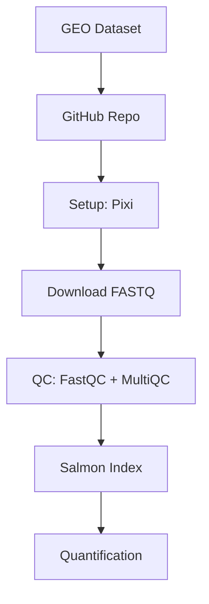
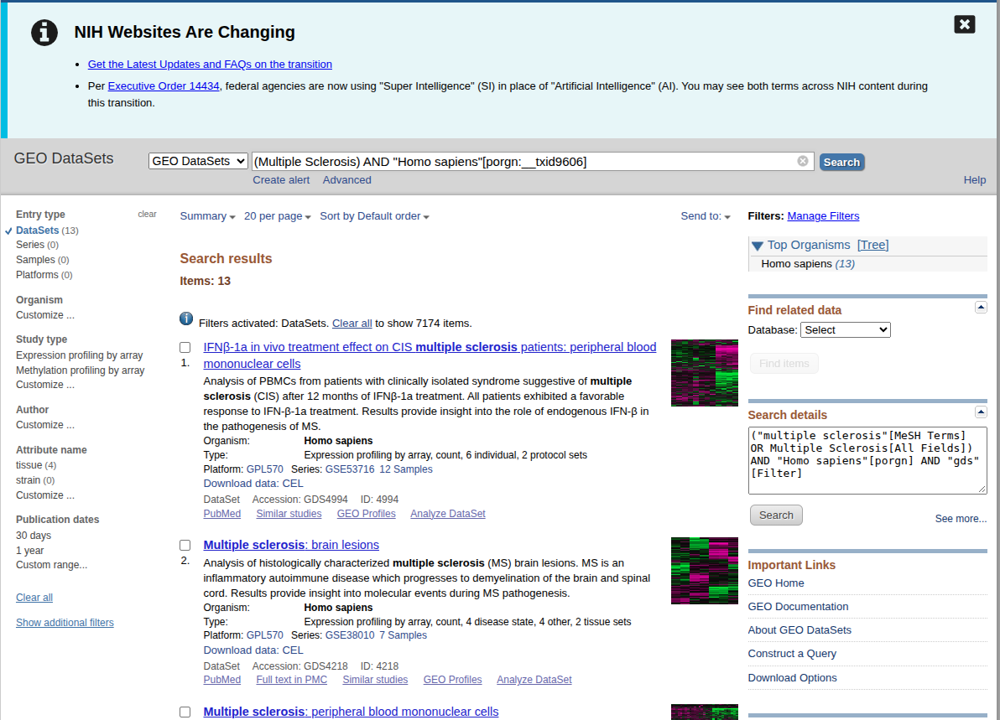
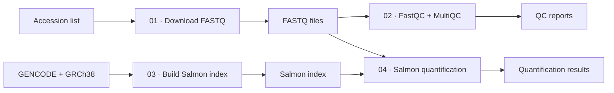

# Day 06: Bulk RNA-seq, Project Setup, Data Searching and Running Scripts

A beginner-friendly, step-by-step guide.



---

## Part 1: Searching for Data (NCBI GEO)

GEO (Gene Expression Omnibus) is a public database of gene expression datasets.
Open: [https://www.ncbi.nlm.nih.gov/gds](https://www.ncbi.nlm.nih.gov/gds)

### Step-by-step search

| Step | What to do                                                       | Example                                      |
| ---- | ---------------------------------------------------------------- | -------------------------------------------- |
| 1    | Type your **area of interest / disease** in the search box | `asthma`, `COVID-19`                     |
| 2    | Choose **Entry type: Datasets** (these are GSE series)     | Datasets                                     |
| 3    | Choose **Organism**                                        | Homo sapiens (human) or Mus musculus (mouse) |
| 4    | Choose **Tissue / cell type**                              | PBMC                                         |
| 5    | Check **sample size** and **year**                   | enough samples per group, recent study       |



### Record your search counts (for the paper)

After **each** filter, write down the number of results. This documents your search for the Methods section of a paper.

| Filter applied             | Results |
| -------------------------- | ------- |
| Area of interest / disease |         |
| + Entry type: Datasets     |         |
| + Organism                 |         |
| + Tissue (PBMC)            |         |
| + Sample size / year       |         |

Also save: the **search date** and the **final accession** you chose (for example `GSE52778`).

### Get the run accessions (SRR numbers)

Raw sequencing files are stored in SRA under SRR accessions. From the GEO page, follow the link to the SRA Run Selector and download the accession list. Save it as `inputs/SRR_Acc_List.txt`, one accession per line:

```
SRR1039508
SRR1039509
```

---

## Part 2: Project File Structure

```
day-06/
├── inputs/       # things the pipeline READS (accession list, reference files, indexes)
├── outputs/      # things the pipeline PRODUCES (QC reports, quantification)
├── scripts/      # numbered shell scripts, one per step
├── fastq/        # downloaded raw reads
├── pixi.toml     # environment definition
└── README.md   # this file
```

**Why this structure?** Keeping inputs, outputs and scripts separate means you always know what is raw data, what is code, and what is a result. Numbering scripts (`01_`, `02_`, ...) shows the order to run them.

---

## Part 3: Project Setup (step by step)

### Step 1: Create a GitHub repository and clone it

1. On GitHub click **New repository**.
2. Give it a name, tick **Add a README** and choose a **LICENSE**.
3. Tick git ignore
4. Copy the repository URL, then in your terminal:

```bash
git clone <your-repo-url>
cd <your-repo-name>
```

### Step 2: Open a new terminal and check git

In VS Code: **Terminal > New Terminal**.

```bash
git --version
```

If a version number prints, git is installed.

### Step 3: Create the folders

```bash
mkdir inputs outputs scripts
```

### Step 4: Install `tree` and check the structure

`tree` draws your folders as a diagram.

```bash
sudo apt install tree
tree -L 2
```

`-L 2` means "show only 2 levels deep".

### Step 5: Set up pixi (the environment manager)

pixi installs the bioinformatics tools in an isolated environment, so your project is reproducible on any computer.

```bash
pixi --version        # check pixi is installed
pixi init .           # create pixi.toml in the current folder
```

Add the bioconda channel (where bioinformatics tools live) and install the tools:

```bash
pixi workspace channel add bioconda
pixi add fastq-dl fastqc salmon multiqc
```

> Older pixi versions use `pixi project channel add bioconda` instead.

Your `pixi.toml` will look like this:

```toml
[workspace]
channels = ["conda-forge", "bioconda"]
name = "Bmp_practice"
platforms = ["linux-64"]
version = "0.1.0"

[dependencies]
fastq-dl = ">=4.0.1,<5"
fastqc = ">=0.13.0,<0.14"
salmon = ">=2.8.0,<3"
multiqc = ">=1.35,<2"
```

Two ways to use the installed tools:

```bash
pixi shell               # open a shell where all tools are available
pixi run fastqc --help   # or run one command inside the environment
```

### Step 6: Install the "Even Better TOML" extension

1. In VS Code open Extensions (`Ctrl+Shift+X`).
2. Search **Even Better TOML** and click **Install**.

It adds colours, error checking and formatting for `pixi.toml`.

---

## Part 4: How to Run Scripts

A shell script is a text file containing terminal commands that run one after another. Scripts make your work repeatable: run the same file tomorrow and get the same result.

### Anatomy of a script

```bash
#!/usr/bin/env bash      # "shebang": tells Linux to run this file with bash
# This is a comment, ignored by the computer
echo "Hello"             # a command
```

### Method 1: Make it executable, then run with `./`

```bash
cd scripts                       # move into the scripts folder
ls -l                            # check permissions (no 'x' yet)
chmod +x 02_quality_control.sh   # give permission to execute
ls -l                            # now you will see 'x' (and often green text)
./02_quality_control.sh          # run the script
```

- `chmod` = change mode (permissions)
- `+x` = add the **execute** permission
- `./` = "run the file in this folder"

### Method 2: Run with `bash` (no chmod needed)

```bash
bash 02_quality_control.sh
```

### Which one should I use?

|                       | `chmod +x` then `./script.sh` | `bash script.sh`            |
| --------------------- | --------------------------------- | ----------------------------- |
| Needs `chmod` first | Yes                               | No                            |
| Uses the shebang line | Yes                               | No (you choose bash yourself) |
| Good for              | Scripts you will run many times   | Quick tests                   |

### Running scripts inside the pixi environment

The tools (fastqc, salmon, ...) only exist inside the pixi environment, so run scripts like this:

```bash
pixi shell                       # enter the environment first
./02_quality_control.sh          # then run as usual
```

or in one line:

```bash
pixi run bash 02_quality_control.sh
```

### Important: run scripts from the right folder

Scripts 02 to 04 use paths like `../inputs/` and `../outputs/`. The `..` means "one folder up", so these scripts expect you to run them **from inside the `scripts/` folder**.

```bash
cd scripts
bash 02_quality_control.sh
```

### Common errors

| Error message                 | Cause                                 | Fix                                                  |
| ----------------------------- | ------------------------------------- | ---------------------------------------------------- |
| `Permission denied`         | Script is not executable              | `chmod +x script.sh`                               |
| `command not found: fastqc` | Not inside pixi environment           | `pixi shell` or `pixi run ...`                   |
| `No such file or directory` | Wrong folder, or wrong path           | Check with `pwd` and `ls`; run from `scripts/` |
| `bad interpreter`           | Windows line endings or wrong shebang | Check the first line is `#!/usr/bin/env bash`      |

---

## Part 5: The Pipeline Scripts

Run them in order. Each one needs the output of the one before (or its own input files).



### Script : Download FASTQ files

Reads each accession in `inputs/SRR_Acc_List.txt` and downloads it with `fastq-dl` into `fastq/`.

```bash
bash 01_download_fastq.sh
```

**Result:** `.fastq.gz` files (paired-end: `_1` and `_2`) in `fastq/`.

```bash
bash 02_quality_control.sh
```

## Part 6: Save Your Work with Git

```bash
git status                  # see what changed
git add .                   # stage all changes
git commit -m "Day 06: setup, data search, download and QC scripts"
git push                    # upload to GitHub
```

Do **not** commit large files (FASTQ files, indexes, the `.pixi/` folder). Add them to `.gitignore`:

```
.pixi/
fastq/
inputs/human_salmon_index/
inputs/*.fa.gz
```

---

## Quick Glossary

| Term    | Meaning                                          |
| ------- | ------------------------------------------------ |
| GEO     | Public database of gene expression datasets      |
| GSE     | A GEO series (one study)                         |
| SRR     | A sequencing run accession in SRA                |
| FASTQ   | File format for raw sequencing reads             |
| FastQC  | Tool that checks the quality of reads            |
| MultiQC | Combines many QC reports into one                |
| Salmon  | Fast tool to quantify transcript expression      |
| Index   | A prepared reference that makes alignment fast   |
| pixi    | Tool that manages software environments          |
| Shebang | First line of a script (`#!/usr/bin/env bash`) |
